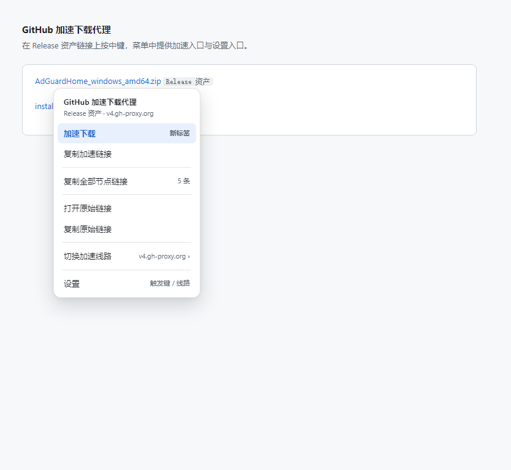
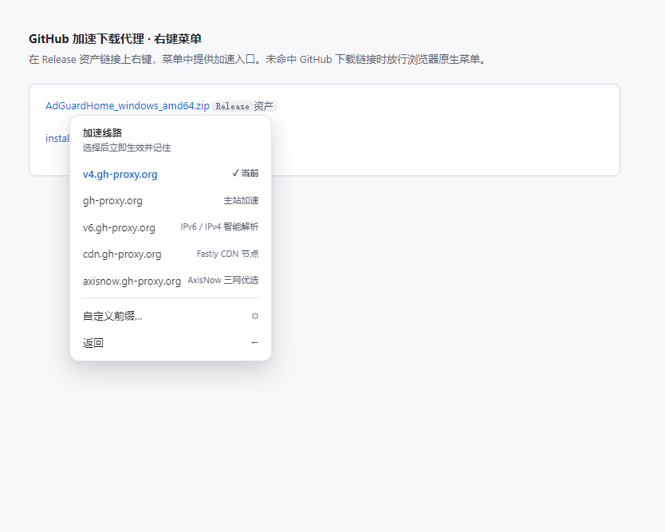
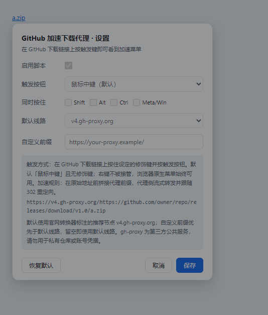

# GitHub 加速下载代理（右键菜单）

一个 Tampermonkey 脚本：在任意页面的 GitHub 下载链接上右键，弹出菜单里多出「GitHub 加速下载代理」，按 gh-proxy 官方转换规则生成加速链接。未命中 GitHub 下载链接时，浏览器原生右键菜单原样放行。

加速规则与 [gh-proxy.com](https://gh-proxy.com/) 官网「转换链接」按钮的输出**逐字一致**，默认使用官网标注推荐的 `v4.gh-proxy.org` 节点。

## 功能

- 右键 GitHub 下载链接，一键在新标签页打开加速地址
- 复制加速链接、复制全部 5 条官方节点链接、复制/打开原始链接
- **返回浏览器原生右键**：菜单项预授权，或按住修饰键直达（见下文）
- 5 条官方节点线路随时切换，含 IPv4 优选、IPv6 智能解析、Fastly CDN、三网优选
- Git 仓库链接自动给出 `git clone` 加速命令
- 支持自定义代理前缀
- 亮 / 暗主题自适应；仅命中下载资源时接管右键，其余场景零干扰

## 界面

主菜单（Release 资产链接右键）：



5 条官方线路切换：



设置面板：



## 安装

1. 浏览器安装 [Tampermonkey](https://www.tampermonkey.net/)（或 Violentmonkey）。
2. 直接点击仓库 Raw 文件安装：`github-proxy-contextmenu.user.js`。
3. 或打开 Tampermonkey 控制面板 → 新建脚本 → 粘贴本仓库脚本全文 → 保存。

脚本头部已声明 `@updateURL`（指向 `.meta.js`）与 `@downloadURL`（指向完整脚本），后续版本可通过 Tampermonkey 自动检查更新。

### 更新机制

| 文件 | 体积 | 角色 |
|---|---|---|
| `github-proxy-contextmenu.meta.js` | 约 1.1 KB | 更新检查地址（`@updateURL`），只含元数据头，TM 读取其中的 `@version` |
| `github-proxy-contextmenu.user.js` | 约 40 KB | 脚本本体，检测到新版后从 `@downloadURL` 下载安装 |

TM 每次检查只拉取 1.1 KB 的元数据文件，而不是整份脚本。手动触发：猴子图标 → 管理面板 → 选中脚本 → 检查更新；检查频率可在设置 → 通用 → 更新检查频率中调整。

> 注意：若本地已安装过 `v1.x` / `v2.x` 的早期版本，由于版本号回退，TM 不会提示更新，需卸载后重新安装。

## 使用

在任意网页上找到 GitHub 下载链接，右键即可看到加速菜单。支持的资源类型：

| 类型 | 链接形式 |
|---|---|
| Release 资产 | `github.com/{owner}/{repo}/releases/download/{tag}/{file}` |
| 最新 Release | `github.com/{owner}/{repo}/releases/latest/download/{file}` |
| 源码归档 | `github.com/{owner}/{repo}/archive/refs/{heads\|tags}/…` |
| Raw 文件 | `github.com/{owner}/{repo}/raw/…`、`raw.githubusercontent.com/*` |
| Gist 原始文件 | `gist.github.com/{user}/{id}/raw/…`、`gist.githubusercontent.com/*` |
| 仓库打包 | `codeload.github.com/*`、`zipball`、`tarball` |
| API 资源 | `api.github.com/…/releases/assets/…`、`zipball`、`tarball` |
| Git 克隆 | `github.com/{owner}/{repo}.git`（菜单提供复制加速 clone 命令） |

仓库主页、issue、PR 等非下载类页面链接不会被接管。已是代理地址的链接不会被二次加速。

## 返回浏览器原生右键

浏览器只允许由真实用户操作触发的 `contextmenu` 事件唤起原生菜单，网页脚本无法主动弹出它。因此提供两条通道：

1. **菜单项**：点击菜单中的「返回浏览器原生右键」，然后**在同一个链接上再次右键**——脚本这次直接放行，浏览器原生菜单正常显示（一次性授权，换链接或改动目标即失效）。
2. **修饰键直通**：按住 `Shift` / `Alt` / `Ctrl` / `Meta` 任意一键再右键，立即跳过脚本菜单，直接显示浏览器原生菜单。这是最快捷的方式。

原生菜单可用于使用浏览器的「在新标签页打开」「复制链接地址」「检查」等内置功能。

## 加速规则

前缀代理模型：在原始完整 URL 前拼接节点前缀。

```text
原始：https://github.com/owner/repo/releases/download/v1.0/a.zip
加速：https://v4.gh-proxy.org/https://github.com/owner/repo/releases/download/v1.0/a.zip
```

**节点线路**（gh-proxy 官方转换器输出，与官网保持一致）：

| 节点 | 说明 |
|---|---|
| `v4.gh-proxy.org` | 官网标注「推荐」，IPv4 优选（默认） |
| `gh-proxy.org` | 主站加速 |
| `v6.gh-proxy.org` | IPv6 / IPv4 智能解析 |
| `cdn.gh-proxy.org` | Fastly CDN 节点 |
| `axisnow.gh-proxy.org` | AxisNow 三网优选 |

> 说明：`gh-proxy.com` 是官网 UI 域名，官网转换器本身并不用它做加速前缀。本脚本的 5 条线路均取自官网转换器的实际输出。

## 设置

通过 Tampermonkey 图标菜单中的「设置」打开面板，可配置：

- 启用 / 停用右键接管
- 默认线路
- 自定义代理前缀（留空则使用默认线路）

配置通过 `GM_setValue` / `GM_getValue` 持久化。

## 技术实现

Tampermonkey 没有向浏览器原生右键菜单追加菜单项的 API（那是浏览器扩展 `contextMenus` 权限的能力）。本脚本采用等效方案：

1. `document-start` 阶段在 `document` 上以捕获方式监听 `contextmenu`；
2. 用 `event.composedPath()` 逐层回溯，定位命中的 `<a href>`，可穿透 Shadow DOM；
3. 命中 GitHub 可下载资源时 `preventDefault` + `stopPropagation`，绘制仿原生菜单；未命中则完全放行。

## 隐私与安全

gh-proxy 是第三方公共服务，仅用于 GitHub 公开资源的加速下载。请勿通过任何代理传输账号凭据或私有仓库内容。

## 许可证

[MIT](LICENSE)
